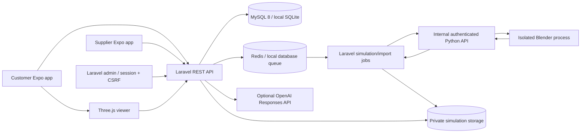

# Architecture (historical)

This document describes the earlier workspace design. The current system has three standalone React Native Android apps, three PHP APIs, and one shared MySQL database. Use the [current instructions](../../README.md) for project structure and run commands.

## Boundaries

Laravel is the shared business backend. Apps send bearer tokens issued by Sanctum; native tokens are held in Expo SecureStore. Web exports are development previews and keep tokens in sessionStorage. The admin uses Laravel's session guard, CSRF forms and a server-side admin role check.

The workspace keeps three portal folders separate: `customer`, `supplier`, and `admin`. Customer and supplier have separate Expo configurations, routes, builds, and development ports. Admin is hosted by Laravel at `/admin` because its server-rendered forms use Laravel sessions, CSRF protection, and backend services directly. All authenticated admin routes pass through the `administrator` middleware before reaching a controller. The three portals share one API and database so catalog, requests, and inventory stay consistent.

Every supplier operation resolves the caller's owner/member relationship. Owners manage membership; managers manage profile and branches; staff can update listings and quote requests. Suspended shops disappear from marketplace results and lose supplier access. Self-registration cannot assign privileged roles.

The shared catalog is independent of supplier inventory. Creating a listing references a catalog part and branch. Transactions lock the listing before changing stock and recording audit history. Request acceptance locks the request, accepts one offer, declines remaining offers and closes the request. An accepted quotation is not an online order or stock reservation.

## Search and AI

Catalog queries apply the selected vehicle variant and optional category/search term. Normalized numbers remove punctuation and uppercase Latin letters/digits. Human review is required before introducing a manufacturer with different number semantics.

The AI endpoint retrieves relevant catalog rows before asking the external provider for prose. It never executes model-generated SQL, grants access or submits purchases. Replies and user messages persist only after a successful provider response. Failure returns HTTP 503. Without credentials, a deterministic catalog response explicitly labels itself as non-AI. Conversation access is owner-scoped.

## Files and simulations

Photos and GLB uploads retain a source/license record. Customer photos use private storage and an authorized streaming endpoint. Generated animations also use private storage. The public model endpoint verifies procedure approval at each request; admin candidate previews require an admin session.

A generated GLB is a candidate. The worker validates the model container, rejects external resources, checks required named meshes and runs Blender with auto-execution disabled. It is not a mechanical validation system. Admin review must be carried out by a qualified person using licensed, vehicle-specific procedure sources.

## Runtime choices

Development defaults to SQLite, database queues and local files. Production configuration targets MySQL, Redis and S3-compatible storage. The Python worker is reachable only through an internal API with a shared secret; it does not receive database credentials. Docker Compose does not expose the worker or database to the host.

Source references used during implementation:

- [Laravel Sanctum](https://laravel.com/docs/12.x/sanctum)
- [Expo SDK 54 compatibility](https://docs.expo.dev/versions/v54.0.0/)
- [OpenAI text generation / Responses](https://developers.openai.com/api/docs/guides/text)
